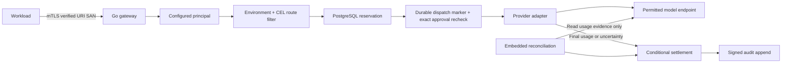
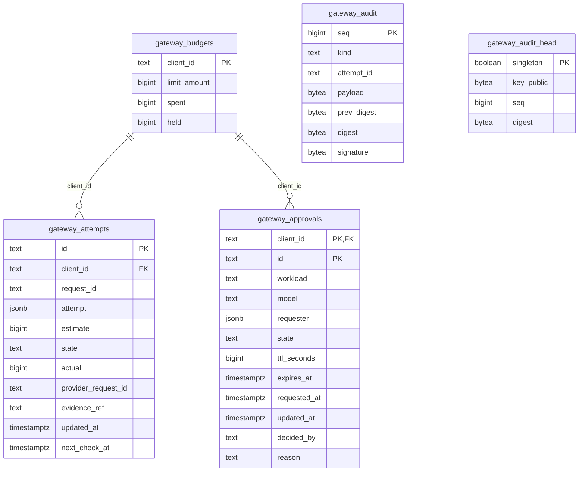

# Technical deep dive: policy, money and uncertain completion

This document explains the public educational reconstruction. It contains design choices supported by this source, not claims about an employer's implementation, a customer's deployment or an individual's production ownership. The bounded problem is a common model interface whose requests must remain inside configured identity, environment, budget and reliability limits.

## One request across the boundaries



1. TLS verifies the client certificate. The application accepts exactly one URI SAN and maps it to a configured client/workload/department/app/role. Caller identity override headers are rejected.
2. Startup-compiled CEL and the trusted environment/route inventory select eligible models. Capability hints avoid unsupported routes. An unavailable eligible set returns an error; a cheaper disallowed provider remains disallowed.
3. Each provider attempt gets a distinct attempt ID and its own estimated budget hold. Attempts share a request ID for tracing. A failed reservation returns before inference.
4. A dispatch transaction records possible provider execution before network I/O. A protected route must recheck the exact durable grant's scope, state and fresh expiry inside that transaction. Revocation has a defined serialization point against dispatch.
5. The adapter makes a bounded request to its configured origin with redirects disabled. It normalizes structured outcomes and usage. Capability/transient failure may use another eligible route subject to attempt/deadline/budget limits. Explicit safety refusal is terminal.
6. Final evidence settles once. Unknown completion retains its hold. A fallback reserves separately; it cannot reuse money that an earlier attempt may already have spent.

## Physical PostgreSQL model

The authoritative DDL is [`internal/ledger/schema.sql`](../internal/ledger/schema.sql). There are five tables, 38 columns, two declared foreign keys and four explicit partial indexes, plus primary-key indexes. There is no request, provider, policy, normalized user or durable message-queue table.



Only the two budget-child links are physical foreign keys. `audit.attempt_id`, `attempt.request_id`, approval IDs inside the attempt JSON and audit-head sequence/digest are application-enforced correlations. A unique partial audit index over `settled` and `manual_resolution` allows at most one final-settlement-kind record per attempt. Other partial indexes select uncertain due work, reserved/dispatching stale work, and approved grants.

Config owns identity maps, route inventory, CEL/version/rule, endpoint metadata, rates and credential environment-variable names. The attempt JSON preserves the principal, chosen route and decision snapshot. Signed audit payloads contain structured decision/accounting metadata. Prompts and completion bodies flow through sockets and are not stored by this ledger, while identities/reasons/endpoints remain sensitive metadata.

## Atomic reservation and single settlement

Available units are `limit_amount - spent - held`. `Store.Reserve` uses a conditional update inside a transaction:

```sql
UPDATE gateway_budgets SET held = held + $2
WHERE client_id = $1
  AND limit_amount::numeric - spent - held >= $2::bigint;
```

If two callers each ask for 10 with only 15 available, PostgreSQL serializes the conflicting row update and reevaluates the predicate. One succeeds. The same transaction inserts the attempt and appends the signed audit record. A duplicate ID or audit failure rolls back the hold. Numeric comparison avoids overflow in the availability calculation.

```text
reserved -> dispatching -> settled
    |             |
    |             +-> uncertain -> final evidence -> settled
    |                             -> no evidence -> remain held
    +-> stale, no committed dispatch -> released
```

Settlement uses a conditional state update to authorize one balance mutation. If estimated hold was 10 and confirmed usage is 7, one transaction removes 10 held, adds 7 spent and appends the final event. A matching repeated settlement returns without another balance update; conflicting confirmed amounts/provider identity fail for review. The partial audit uniqueness constraint is backup protection, not a separate settlement-record service.

When these resources are required, mutation lock order is budget, attempt, then audit head. This reduces inconsistent lock ordering. The budget and global audit head can become contention points; no throughput measurement is inferred from correctness tests. Actual confirmed usage may exceed the estimate and is still recorded, so reservation is an admission limit rather than a perfect invoice cap.

## Reconciliation and PostgreSQL session ownership

The embedded worker performs an immediate pass, then waits a fixed delay after each pass. It recovers stale rows, reads due pending attempts in bounded batches and calls a usage lookup outside a long-running database transaction. Final evidence invokes conditional settlement; absent evidence defers the next check and retains the hold. It never replays inference.

A definitely unsent stale reservation can be released. A committed dispatch marker means a crash may have occurred before or after bytes reached the provider: conservative recovery marks uncertainty. Fixture providers offer exact per-attempt usage lookup. Generic vendor adapters cannot recover an arbitrary unknown request's exact charge and leave it pending for provider-specific evidence or audited manual resolution.

Multiple replicas sharing a database/key pin one PostgreSQL connection for a session advisory lock. Acquire, probe and unlock use that session. Losing the session cancels the old scan; a partition can delay detection and overlap work, so conditional settlement remains the financial correctness boundary. Ambiguous unlock or cleanup failure discards the physical session instead of returning it to the pool with unknown lock state. A pinned connection consumes a pool slot; the reference does not tune a production pool limit.

`integration/lockwire` tests a real proxy that forwards unlock but withholds its reply. An observer proves the old backend is alive with its lock released, then proves its exit before a pool probe, and another worker acquires the key. A separate healthy-session cleanup fault verifies explicit discard. Backend-loss tests verify cancellation and takeover; no-double-settlement is asserted separately by real PostgreSQL ledger/reconciliation tests.

## Signed audit and key continuity

The ledger serializes its head row, assigns sequence numbers, hashes canonical event bytes and the previous digest with SHA-256, signs using Ed25519 and commits the append/head with the accounting mutation. Startup checks expected signing-key continuity and verifies existing history before serving.

A signature is not encryption or immutable storage. The runtime role owns these tables. A consistent rollback of chain and head can evade detection without an independent retained checkpoint. Preserve the signing key across releases; replacing it breaks verification. Cloud KMS envelope/key-history management, independent anchors and key-compromise recovery are not implemented here.

## Code, data, events, traffic and authorization

| Function | Code | Durable data/event | Traffic | Authority |
|---|---|---|---|---|
| Ingress | `gateway.Server.complete`, `principal` | Request ID; denials can append audit metadata | mTLS HTTPS | Verified single URI SAN + configured map; no caller tenant override. |
| Route choice | `config.go`, CEL | Policy version/rule in attempt/decision | No provider call yet | Client environment and policy remain prerequisites. |
| Reserve | `ledger.Store.Reserve` | Conditional budget hold + attempt + audit transaction | PostgreSQL | Trusted principal and configured rates. |
| Protected dispatch | `approval.GrantID`, `Store.MarkDispatch` | Exact grant, expiry/state check and dispatch marker | PostgreSQL, then provider | Same client/workload/model grant; no policy or budget expansion. |
| Provider call | `provider.go`, `vendor.go`, `stream.go` | Provider request ID and evidence when available | Configured HTTPS origin; optional loopback fixture | Named provider credential; redirects disabled. |
| Settlement | `Store.Settle` | Conditional final transition + balance + signed event | PostgreSQL | Confirmed normalized usage and consistent provider evidence. |
| Reconcile | `Worker.Run`, `Locked.RunOnce` | Due/stale transitions, settlement or defer | Pinned DB session + usage lookup | Saved route/account; no inference replay. |
| Reporting | `Store.Report`, CLI | Group snapshot scope/model/state; no prompt rows | Local DB | OS/database operator boundary. |
| Shutdown | `serve`, tracked handler | Existing commits persist; unknown usage remains recoverable | Drain/cancel bounded network work | Existing request contexts, no new admission. |

## Decisions and tradeoffs

| Decision | Reason | Cost / boundary |
|---|---|---|
| Go binary across environments | Simple distribution and concurrent networking. | Shared gateway adds a network dependency; single binary does not establish sovereignty. |
| Policy before ranking/fallback | Denied destinations stay denied under outage. | Reliability is limited to permitted routes. |
| Separate each attempt's reservation | Uncertain first work may still cost money. | Holds reduce availability until evidence resolves them. |
| Durable dispatch before network | Recovery cannot overlook possibly billed work. | A crash just before send can conservatively retain an unnecessary hold. |
| State-guarded transaction | Duplicate handlers/workers cannot apply the same charge twice. | Per-client and audit-head row contention; measure before scaling. |
| CEL in startup configuration | Executable policies with recorded rule/version. | No Cedar engine or live policy-distribution system in this reconstruction. |
| Bounded text/SSE adapters | Normalize useful text and usage contracts. | Not complete vendor API parity or invoice modelling. |
| No fallback after emitted content | A second provider cannot retract already delivered deltas. | Truncation/refusal after content becomes an explicit stream error with conservative accounting. |
| Model device control separately | Exercise configured HTTPS routes and expiring access decisions. | No actual fleet MDM/VPN/DNS enforcement; direct provider usage is outside gateway accounting. |

## Startup, shutdown and release

Startup opens PostgreSQL, takes a separate transaction-scoped migration lock, applies additive DDL, validates the audit key/history, seeds only missing budgets, compiles/validates routes and configures mandatory TLS. Its 15-second startup context is separate from request/worker lifetimes.

Shutdown closes admission, cancels the worker, drains HTTP for up to ten seconds, then cancels/closes on deadline and uses a shared eight-second join bound. It closes the database pool only after its users join; otherwise process exit releases resources instead of waiting forever on an unsafe close. Uncertain provider work remains durable.

The local lab is self-contained. The systemd operator template is a separate explicitly selected disposable target. Review schema compatibility, rehearse the exact binary, preserve keys/state, test backup restoration and retain the previous compatible binary before promotion. There is no automatic production deployment, multi-region failover, ordered/down migration system, auto-renewal or tested disaster recovery in this code.

## Questions worth challenging

- What happens if permitted models are down but an external one is healthy? Trace zero forbidden-provider calls and a terminal error.
- If a provider times out, what proves releasing its hold is safe? A timeout alone proves nothing about billing; trace pending evidence and manual review.
- Why both an advisory lock and conditional settlement? The first reduces duplicate work; the second protects money even during delayed lock-loss detection.
- Can revocation cancel a committed provider dispatch? No; it blocks future dispatch according to transaction ordering, not already incurred work.
- What if actual usage exceeds the estimate? Record confirmed usage faithfully; improve estimates/rates instead of erasing spend.
- Can a region string guarantee residency? No; it is a trusted inventory input requiring endpoint, account, network and contractual evidence.
- Can signatures detect a consistent database rollback? Only against an independently retained expected head/checkpoint.
- What is proved by CI? Exercised correctness paths, named real PG assertions, mTLS flow and artifact identity; not production latency, cost or capacity.
